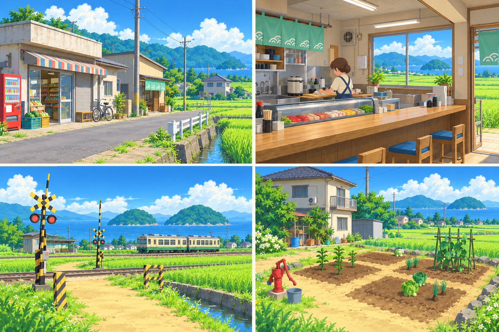
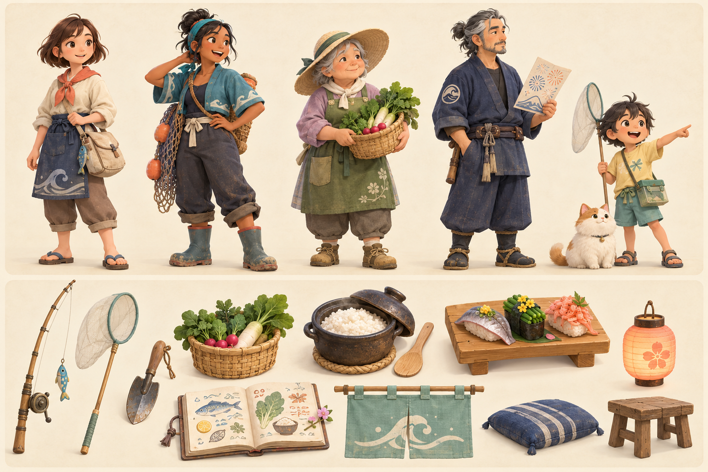

# 晴汐小镇：一间寿司屋

原创 3D 小镇生活 × 寿司店经营游戏概念提案。

**风格更新 v0.4：** 按最新铁路道口与菜园参考图，调整为明亮蓝天、黄绿田地、青绿远山与浅土黄道路；减少照片式细节和高光，采用更简洁的手绘动画背景质感。普通乡间小店、混合住宅、农田、海岛与列车布局延续 v0.3。角色与道具板仍保留初版方向。

回到依山临海的小镇，重开外婆的寿司店。白天钓鱼、抓虫、采野菜、种菜，傍晚研究菜单、招待食客，逐渐拥有自己的家、交到朋友，并让停办多年的海湾花火大会重新亮起来。

## 概念图

### 海湾花火主视觉

### 场景方向：村口小店、寿司店、田野铁路与海岛、住宅菜园

### 角色与道具

## 设计文件

- [完整游戏设计方案](01-游戏设计方案.md)：8 章主线、7 个区域、10 位核心村民、四季活动、采集种植、寿司经营与装修。
- [美术设定与制作规范](02-美术设定与制作规范.md)：色彩、比例、场景尺度、模型与贴图预算、复用和交付要求。
- [美术资源清单 CSV](03-美术资源清单.csv)：157 项制作任务；P0 91 项、P1 66 项、P2 0 项。
- [概念图与交付说明](04-概念图与交付说明.md)：概念板用途、制作边界与下一轮美术稿。
- [离线图册](index.html)：概念图、玩法概述和可搜索、筛选的资源清单。

GitHub 可以直接预览本页图片、Markdown 文档和 CSV。要使用离线图册，在仓库页面选择 **Code → Download ZIP**，解压后打开 `design/index.html`；HTML 与 `concepts` 文件夹需保留相对位置。

## 范围与状态

首个可玩版本规划为七天生活样片：3 个区域、4 位核心村民、3 种鱼、2 种昆虫、1 种野菜、2 种作物、5 道菜、8 件可摆家具和短版花火。

三张图片为 AI 生成的原创概念方向稿。本次交付是游戏与美术设计，没有实现可玩程序，也没有交付可直接导入引擎的模型、骨骼、动作或生产级材质。157 项表示不同单位的制作任务，不能直接视为模型总数。成本、周期、性能和玩法平衡仍需通过原型与团队评估确定。
